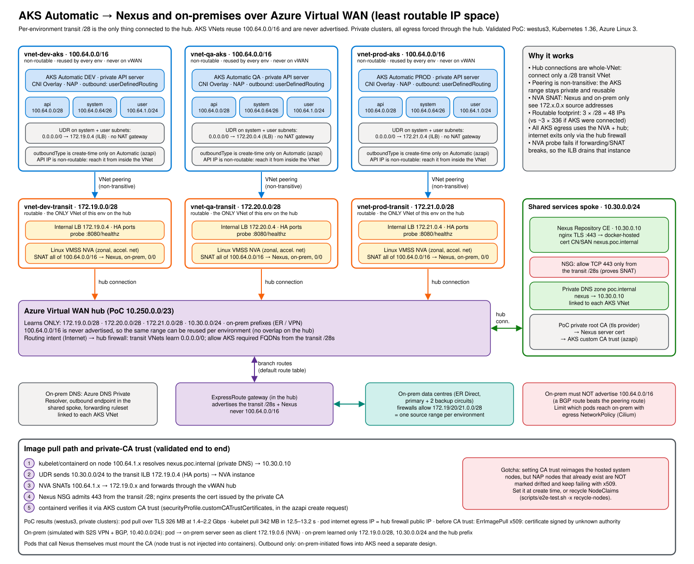

# AKS Automatic → Nexus over Azure Virtual WAN (least routable IP space)

Constraints this design solves for:

- AKS Automatic clusters (DEV / QA / PROD, CNI Overlay, BYO VNet with API `/28`, system `/26`, user `/24`) must pull images from **Nexus**. ACR isn't allowed.
- Nexus lives in a shared spoke that is connected to the **vWAN hub**. AKS → Nexus traffic **must transit the hub**.
- Consume as little routable IP space as possible.
- Then extend the same path to **on-premises** (ExpressRoute behind the hub). See [Extending to on-premises](#extending-to-on-premises).

## Why the original subnet-peering PoC can't be used as-is with vWAN

The repository root peers a single `/28` subnet with **subnet peering**. A vWAN hub connection is always a **whole-VNet** connection, so subnet peering isn't available toward a hub. Connecting the AKS VNet would therefore advertise its entire address space, including the AKS subnets, to the hub (and on to ExpressRoute). If several environments reuse the same non-routable range, you also end up with overlapping VNet connections on one hub, which isn't supported.

## Design: per-environment transit VNet



Editable source: [`docs/architecture.excalidraw`](docs/architecture.excalidraw) (open in Excalidraw).

<details><summary>Text version</summary>

```
                      +--------------------------- vWAN hub ---------------------------+
                      |  learns ONLY: 172.19.0.0/28, 172.20.0.0/28, 172.21.0.0/28,     |
                      |               Nexus spoke prefix                               |
                      |  private clusters: routing intent Internet -> hub firewall     |
                      +-------^------------------^------------------^---------^--------+
                  hub conn    |       hub conn   |       hub conn   |         | hub conn
              +---------------+--+  +------------+-----+  +---------+--------+  +-----+-----------------+
              | vnet-dev-transit |  | vnet-qa-transit  |  | vnet-prod-transit|  | AKS Shared Infra      |
              | 172.19.0.0/28    |  | 172.20.0.0/28    |  | 172.21.0.0/28    |  | (Nexus)               |
              | ILB .4 (HA ports)|  | ILB .4           |  | ILB .4           |  | NSG: allow only the   |
              | VMSS SNAT NVA    |  | VMSS SNAT NVA    |  | VMSS SNAT NVA    |  | transit /28s          |
              +--------^---------+  +--------^---------+  +--------^---------+  +-----------------------+
                VNet peering           VNet peering          VNet peering
              +--------+---------+  +--------+---------+  +--------+---------+
              | vnet-dev-aks     |  | vnet-qa-aks      |  | vnet-prod-aks    |
              | 100.64.0.0/16    |  | 100.64.0.0/16    |  | 100.64.0.0/16    |   <- same range, never on vWAN
              | api /28 sys /26  |  | api /28 sys /26  |  | api /28 sys /26  |
              | user /24         |  | user /24         |  | user /24         |
              | UDR: 0/0 -> .4   |  | UDR: 0/0 -> .4   |  | UDR: 0/0 -> .4   |   <- private clusters (public: Nexus -> .4)
              +------------------+  +------------------+  +------------------+
```

</details>

1. **Only the transit VNet is connected to the hub.** The hub learns one `/28` per environment.
2. **The AKS VNet is peered only to its own transit VNet.** Peering is non-transitive, so the hub never learns `100.64.0.0/16`, and every environment can reuse it.
3. **A UDR on the AKS node subnets** sends the Nexus prefix to the transit NVA's internal LB (HA ports).
4. **The NVA (Linux VMSS) SNATs** node traffic (`100.64.0.0/16 → Nexus`) to its own transit IP. Nexus replies to a routable transit address through the hub.
5. **Private clusters (default, `private_clusters = true`).** The API server is private and the AKS UDR also sends `0.0.0.0/0` to the transit next hop (AKS `outboundType = userDefinedRouting`, no NAT gateway). The NVA SNATs **all** AKS traffic, and internet-bound flows follow the hub's default route to the hub firewall (forced tunnelling). With `private_clusters = false`, internet egress stays on a per-environment NAT gateway and only Nexus/on-prem traffic uses the transit. See [Private clusters with forced tunnelling](#private-clusters-with-forced-tunnelling-tested).

**Routable footprint:** 3 × `/28` = 48 addresses, instead of about 3 × 336 if the AKS subnets were hub-connected.

## What's in this folder

| File | Purpose |
|---|---|
| `main.tf` | Resource group, PoC vWAN + hub (or `existing_virtual_hub_id`), Nexus stand-in spoke + VM, one `aks-env` module per environment |
| `modules/aks-env/` | Transit VNet + hub connection, AKS VNet + peering, UDR, ILB + SNAT VMSS, AKS Automatic cluster via `azapi_resource` (private with `userDefinedRouting`, or public with a NAT gateway) including custom CA trust, optional PoC Azure Bastion + jump VM without a public IP (`create_bastion`) |
| `modules/aks-env/nva-cloud-init.yaml.tftpl` | IP forwarding, `MASQUERADE` (all AKS traffic for private clusters, otherwise only private destinations), HTTP `/healthz` probe that fails if forwarding or SNAT is missing |
| `nexus-cloud-init.yaml.tftpl` | Nexus Community Edition in Docker. Ports 8081/8082 are bound to localhost; nginx terminates TLS on 443 with a cert from the PoC private CA (`/v2/` → `docker-hosted` connector) |
| `k8s/nexus-pull-test.yaml.tftpl` | Job: crane logs in to Nexus over TLS (trusting `ca.crt` through `SSL_CERT_FILE`), pushes a seed image through the path, pulls it back, prints MB/s |
| `k8s/kubelet-pull-test.yaml.tftpl` | Pod that the **kubelet/containerd** pulls from Nexus using `imagePullSecrets`. This is the custom CA trust test |
| `scripts/e2e-test.sh` | End-to-end test: hub routes, NVA health, CA trust, pod pull, kubelet pull (recycles NAP nodes on x509), private-cluster egress, on-prem |
| `docs/architecture.{svg,excalidraw}` | Architecture diagram |
| `onprem-sim.tf`, `onprem-echo-cloud-init.yaml` | Optional simulated on-prem: VNet + VPN gateway + BGP to the hub, and an HTTP echo server |
| `azfw-test.tf` | Optional Azure Firewall transit for one environment, replacing its NVA as next hop (`create_azfw_test`) |
| `hub-firewall.tf` | Optional PoC secured hub: Azure Firewall + Internet routing intent, standing in for the production hub firewall (`create_hub_firewall`) |
| `terraform.tfvars.example` | All three environments on an existing hub, all reusing `100.64.0.0/16` |

By default only `dev` is deployed in `westus3`, along with a new PoC hub and a Nexus stand-in VM. The NVA uses `Standard_D2s_v4` and Nexus uses `Standard_D4s_v4`, because DSv5 isn't offered to every subscription in West US 2/3.

Terraform also creates:
- A private root CA (`tls` provider). Its certificate is written to `./ca.crt`.
- A Nexus server cert for `nexus.poc.internal`.
- A private DNS zone `poc.internal` linked to each AKS VNet.
- **AKS custom CA trust** with the private root CA on every cluster (`enable_custom_ca_trust`, default `true`). The cluster is created with `azapi_resource` (see below), and `securityProfile.customCATrustCertificates` (base64 of the PEM) is part of the create request.

## Deploy and test

```bash
cd vwan-nexus
terraform init
# Private clusters need a hub default route; in the PoC hub that's create_hub_firewall.
# Bastion lets the e2e script reach the private API servers (az CLI `bastion` extension).
terraform apply -var create_hub_firewall=true -var create_bastion=true

./scripts/e2e-test.sh -x all         # ENV_NAME=qa|prod for other environments
```

`scripts/e2e-test.sh` reads everything it needs from `terraform output` and fails on the first broken invariant:

| Verb | Asserts |
|---|---|
| `setup` | Fetches a kubeconfig (`.kubeconfig-<env>`, gitignored). For a private cluster, points it at `127.0.0.1:<port>` (keeping TLS verification against the private FQDN) and opens a Bastion native-client tunnel to the jump VM's SSH port plus an SSH forward to the API server IP (key and socket in `$TMPDIR`). Creates `nexus-cred`, `nexus-pull` (dockerconfigjson) and the `nexus-ca` configmap. The password only travels through pipes, never argv |
| `routing` | Hub effective routes: the transit connection gets `10.30.0.0/24`, the Nexus connection gets the transit `/28`, and `100.64.0.0/16` appears on **neither** |
| `nva` | ILB `DipAvailability` is 100%. The probe fails if forwarding or SNAT is broken |
| `ca-trust` | The private CA is present in `securityProfile.customCATrustCertificates` |
| `pod-pull` | crane Job over TLS (`SSL_CERT_FILE` = private CA): pushes a seed image through the path, pulls it back, prints throughput |
| `kubelet-pull` | containerd pulls `nexus.poc.internal/poc/seed:1` with `imagePullSecrets`. On `x509` (a NAP node that predates CA trust) it recycles NAP NodeClaims and retries; `RECYCLE_NODES=false` disables that |
| `egress` | Private clusters: `enablePrivateCluster` is true, there is no public FQDN, `outboundType` is `userDefinedRouting`, the transit connection learned `0.0.0.0/0` from the hub, and a pod's internet egress IP is the hub firewall's public IP. Runs in `all` for private clusters |
| `onprem` | With `create_onprem_sim`: the transit connection learns the on-prem prefix, on-prem learns the transit `/28` but never the AKS range, and a pod reaches the on-prem server, which sees an NVA transit IP. Runs in `all` when the simulator exists |
| `nva-reimage` | Reimages NVA instances one at a time and checks each one SNATs every private destination |
| `recycle-nodes` | Deletes all NAP NodeClaims (graceful drain). NAP provisions replacements with the current node config |

The Nexus VM's NSG admits only 443 from the transit `/28`s. A successful pull therefore proves that traffic was SNAT'd by the transit NVA and crossed the vWAN hub.

### PoC results (westus3, AKS Automatic, Kubernetes 1.36, Azure Linux 3)

| Test | Result |
|---|---|
| Hub effective routes | `conn-dev-transit` gets only `10.30.0.0/24`; `conn-shared-nexus` gets only `172.19.0.0/28`. `100.64.0.0/16` is never advertised |
| NVA backends | 100% healthy (zonal VMSS, 2 instances) |
| Pod → Nexus over TLS with private CA (crane) | OK. 325.8 MB in 1.06 s ≈ 307 MB/s (2.6 Gbps, single sample) through NVA + hub, node IP 100.64.1.4 |
| Kubelet pull **before** custom CA trust | `ErrImagePull`: `x509: certificate signed by unknown authority` |
| Custom CA trust on AKS Automatic (`az aks update --custom-ca-trust-certificates`, then the same value via `azapi`) | Accepted. ~16 min the first time (hosted system nodes reimaged); re-applying the same value via `azapi` is a no-op (~3 min, no reimage) |
| Kubelet pull after CA trust, on a NAP node that existed before | Still x509. NAP nodes aren't reimaged and aren't marked `Drifted` |
| Kubelet pull after recycling **all** NAP NodeClaims | OK on fresh nodes. 342 MB pulled and unpacked in 10–18 s |
| Full `e2e-test.sh -x all` | ALL TESTS PASSED |

**Takeaway:** a private CA works for Nexus pulls on AKS Automatic. Set custom CA trust **before** workloads land: this Terraform sets it in the cluster create request. If it is added or rotated later, recycle the NAP NodeClaims (`scripts/e2e-test.sh -x recycle-nodes`). Pods that call Nexus themselves still need the CA mounted, because node trust isn't injected into containers.

### Private clusters with forced tunnelling (tested)

`private_clusters = true` (default) with `create_hub_firewall = true` and `create_bastion = true`. DEV egresses through its NVA; PROD through the Azure Firewall transit (`create_azfw_test`). Both paths end at the PoC hub firewall via Internet routing intent.

| Test | DEV (NVA) | PROD (Azure Firewall transit) |
|---|---|---|
| Cluster | private, no public FQDN, `outboundType = userDefinedRouting`, created in ~15 min | same |
| Node bootstrap with no direct internet path | OK (nodes Ready) | OK once the AKS-to-firewall peering existed (see below) |
| Transit connection learns `0.0.0.0/0` from the hub | yes | yes |
| Pod internet egress IP | hub firewall public IP | hub firewall public IP |
| Pod → Nexus, crane 325.8 MB | 1.91 s (1.43 Gbps) | 1.27 s (2.15 Gbps) |
| Kubelet pull, 342 MB (private CA) | 12.5 s | 13.2 s |
| Pod → on-prem server | `client=172.19.0.6` (NVA) | `client=172.20.0.5` (firewall instance) |
| Full `e2e-test.sh -x all` | ALL TESTS PASSED | ALL TESTS PASSED |

Single samples; treat throughput as indicative.

Findings:

- **`outboundType` must be set when the cluster is created.** On AKS Automatic, `az aks update --outbound-type userDefinedRouting` fails with `OperationNotAllowed: Cannot change ... outboundType while ... nodeProvisioningProfile.mode is Auto`, and `azurerm_kubernetes_automatic_cluster` has no `outboundType` argument. This module creates the cluster with `azapi_resource` (`Microsoft.ContainerService/managedClusters@2026-07-01`, `sku.name = Automatic`) and puts `networkProfile.outboundType`, the private API server settings and custom CA trust in the create request. Switching an existing public cluster to private + UDR means recreating it.
- **The `0.0.0.0/0` next hop must work before the cluster is created.** Nodes bootstrap through it. The UDR, the NVA SNAT rules (or the firewall and its peering) and the hub default route are all dependencies of the cluster. In the first PROD attempt the AKS-to-firewall peering was created after the cluster, which stalled cluster creation until the peering was added.
- **AKS VNets never learn the hub's default route themselves** (they aren't hub-connected). The UDR sends `0.0.0.0/0` to the transit next hop, and the transit connection needs `internet_security_enabled = true` so the transit VNet learns the hub's `0.0.0.0/0`.
- **The hub firewall must allow AKS egress** from the transit ranges (the SNAT'd sources). The PoC rule allows any destination; production should allow the [AKS required outbound FQDNs](https://learn.microsoft.com/azure/aks/outbound-rules-control-egress) only.
- **Reaching the private API server.** Its IP lives in the reused, non-routable `100.64.0.0/16`, so only something inside each AKS VNet can reach it. The PoC subscription drops inbound internet traffic to VM public IPs before the NSG, so the PoC uses Azure Bastion (Standard, native-client tunnelling) to a jump VM **without** a public IP. Bastion IP-based tunnels only allow ports 22/3389, so they can't target the API server's 443 directly. In production use in-VNet build agents or `az aks command invoke`.

## Extending to on-premises

On-prem traffic uses **the same transit `/28` and NVA**. No new routable space is needed, and the AKS VNets still never connect to the hub.

```
AKS node 100.64.x ──UDR(on-prem summaries)──▶ ILB ─▶ NVA (SNAT → 172.19.0.x)
   ─▶ hub connection ─▶ vWAN hub ─▶ ExpressRoute gateway ─▶ ER Direct ─▶ data centres
on-prem learns over ER: the three transit /28s (+ Nexus, hub)   never 100.64.0.0/16
transit VNet learns from the hub: on-prem prefixes (default route table)
```

What changes:

| Where | Change |
|---|---|
| Terraform | Add the on-prem summaries to `onprem_cidrs`. They join Nexus in `private_destinations`, which drives **both** the AKS UDR and the NVA SNAT/FORWARD rules. Internet/MCR stays on the AKS NAT gateway |
| NVA | `upgrade_mode = "Manual"` and cloud-init only runs at provisioning, so roll the new rules out with `scripts/e2e-test.sh -x nva-reimage` (one instance at a time, verifies the rules) |
| Hub / ExpressRoute | Nothing new. The hub's ER gateway already advertises connected VNets (the transit `/28`s) to on-prem and propagates on-prem routes to them |
| On-prem firewalls | Allow the transit `/28`s. Each environment has a stable, distinct source: DEV `172.19.0.0/28`, QA `172.20.0.0/28`, PROD `172.21.0.0/28` |
| Hub firewall (routing intent) | With *private* routing intent, VNet ↔ branch traffic is inspected by the hub firewall. Allow the same `/28`s there |

**Only some workloads need on-prem.** Routing is per subnet, not per pod, so restrict it in the cluster: AKS Automatic runs Cilium, so a default-deny egress `NetworkPolicy` with an `ipBlock` for the on-prem summaries in namespaces that don't need it (or an allow-list in those that do) keeps on-prem reachable only where intended. Image pulls are made by the kubelet on the node and aren't affected by pod network policy.

**DNS.** AKS Automatic uses Azure DNS. Resolve on-prem names with an **Azure DNS Private Resolver**: put the outbound endpoint in the shared (hub-connected) spoke so its queries to on-prem DNS servers are routable, and link a **forwarding ruleset** for the on-prem domains to each AKS VNet. The linked VNets don't need to be peered with the resolver's VNet.

**Gotchas:**
- **On-prem must not advertise the reused AKS range** (`100.64.0.0/16`, or anything more specific inside it). In the transit VNet a BGP route with the same or a longer prefix beats the peering route, breaking return traffic to the nodes. Filter it on the ER edge or with a hub route map on the transit connections. Conversely, on-prem hosts inside `100.64.0.0/16` can't be reached.
- **Keep summaries short.** A route table holds 400 routes and the module allows 50 destinations. Don't let an on-prem summary (for example `10.0.0.0/8`) cover the cluster's pod/service CIDRs (`10.244.0.0/16`, `10.0.0.0/16` by default) or the AKS VNet; set non-overlapping CIDRs at cluster creation.
- **Outbound only.** SNAT supports AKS-initiated flows. On-prem-initiated connections to AKS services need a separate design (for example an internal LB or Private Link service published in the transit VNet).
- **Capacity.** The NVA and the hub now carry image pulls and on-prem traffic. Size NVA instances, hub routing units and ER gateway scale units for both.

### Testing it without ExpressRoute

`-var create_onprem_sim=true` builds a stand-in for the data centres: a VNet (`10.40.0.0/24`) with a VPN gateway that connects to the hub by **site-to-site VPN with BGP**. A branch connection propagates routes the same way ExpressRoute does. An "on-prem server" replies with the client IP it sees, and its NSG admits only the transit `/28`s. Gateways take about 30–45 minutes and cost money while they run.

```bash
terraform apply -var create_onprem_sim=true
./scripts/e2e-test.sh -x nva-reimage   # once, to load the new SNAT rules
./scripts/e2e-test.sh -x onprem        # also part of -x all when the simulator exists
```

Results (westus3, DEV, `onprem_cidrs` simulated by `10.40.0.0/24`):

| Test | Result |
|---|---|
| Hub routes on `conn-dev-transit` | `10.30.0.0/24` (Nexus) + `10.40.0.0/24` (on-prem, via the branch) |
| Routes on-prem learned over BGP | `172.19.0.0/28` (DEV transit), `10.30.0.0/24`, `10.250.0.0/23` (hub). **`100.64.0.0/16` never advertised** |
| NVA rollout (`nva-reimage`) | Both instances reimaged one at a time (~2 min each); each SNATs `10.30.0.0/24` and `10.40.0.0/24` |
| Pod → on-prem server (NSG: transit `/28`s only) | OK. Server saw `client=172.19.0.6`, an NVA transit IP |
| Nexus pulls with on-prem enabled | Unchanged: crane 326 MB at ~2.5 Gbps, kubelet 342 MB in 9.8 s |
| Full `e2e-test.sh -x all` | ALL TESTS PASSED |

## Alternative: Azure Firewall instead of the NVA (tested)

`-var create_azfw_test=true` (see `azfw-test.tf`) adds a separate transit VNet (`azfw_test_cidr`, default `172.20.0.0/25`) with an internal-only Azure Firewall Standard, connects it to the hub and peers it with one environment's AKS VNet (`azfw_test_env`, default `prod`). That environment's UDR next hop moves from the NVA ILB to the firewall's private IP; nothing else changes.

```
AKS node 100.64.x ──UDR──▶ Azure Firewall 172.20.0.4 (SNAT → 172.20.0.x) ─▶ hub ─▶ Nexus / on-prem
```

| Setting | Why |
|---|---|
| `AzureFirewallSubnet` `/26` + `AzureFirewallManagementSubnet` `/26` | Both are fixed minimum sizes, so each environment needs a routable `/25` instead of a `/28` |
| Management NIC, no data-path public IP | Internal only. The management subnet still needs a public IP and a `0.0.0.0/0` route **directly to Internet** (its system route table, gateway route propagation disabled): an exception to any forced egress. The PoC hub has no routing intent, so the connection doesn't propagate a default route |
| Policy `private_ip_ranges = ["255.255.255.255/32"]` | Azure Firewall doesn't SNAT RFC 1918 or `100.64.0.0/10` destinations by default; this forces SNAT so Nexus/on-prem see a routable source |
| Network rule: TCP 80/443 from the AKS VNet to `private_destinations` | Same scope as the NVA |

Results (westus3, PROD, same day as the NVA runs):

| Test | NVA (D2s_v4 × 2) | Azure Firewall Standard |
|---|---|---|
| Hub routes | transit `/28` | `172.20.0.0/25` advertised; `100.64.0.0/16` never |
| Pod → Nexus, crane 325.8 MB | 1.18 s (2.32 Gbps) | 1.52 s (1.80 Gbps) |
| Kubelet pull, 342 MB | 20 s (fresh cluster) | 9.9 s |
| Pod → on-prem server | `client=172.21.0.5` (NVA) | `client=172.20.0.6` (firewall instance) |

Single samples; treat throughput as indicative. Azure Firewall Standard is documented at up to 1.5 Gbps per TCP flow and about 3 Gbps before it autoscales (5–7 minutes per step, 30 Gbps maximum). Burst scale-outs that pull many large images at once can hit that ceiling; consider prescaling.

**One firewall per environment.** Like the NVA transit, a firewall can't be shared while every AKS VNet reuses `100.64.0.0/16`: one VNet can't peer with overlapping VNets, and replies to `100.64.x` would be ambiguous. It also keeps a distinct SNAT source per environment.

**Internet egress.** With public clusters (`private_clusters = false`), pod/node internet traffic doesn't touch this firewall: the UDR only sends `private_destinations` to it, and `0.0.0.0/0` stays on the AKS NAT gateway. With private clusters, the UDR sends `0.0.0.0/0` to it too; it allows and SNATs that traffic, and `AzureFirewallSubnet` forwards it along the hub's default route (forced tunnelling) to the hub firewall, which is the only internet exit. In both cases the firewall's own management traffic uses the management subnet and its public IP.

To revert, set `create_azfw_test=false` and apply: the UDR goes back to the NVA ILB and the firewall is removed.

## Production notes

- **TLS for kubelet pulls.** containerd on AKS Automatic can't be configured for insecure registries.
  - Expose the Nexus Docker repo over **HTTPS** with a certificate the nodes trust: a public CA, or AKS custom CA trust (validated above on Automatic).
  - `azurerm_kubernetes_automatic_cluster` exposes neither custom CA trust nor `outboundType`, so this module creates the cluster with `azapi_resource` and sets `securityProfile.customCATrustCertificates` in the create request (base64 of each PEM, at most 10 certs, LF line endings). Rotating the CA reimages hosted system nodes; recycle NAP NodeClaims afterwards.
  - Prefer Nexus path-based routing or a dedicated hostname over per-repo connector ports.
- **Pull authentication.** Nexus credentials go in `imagePullSecrets` (or a default ServiceAccount patch per namespace). There's no managed-identity pull as with ACR.
- **Throughput.** Every image byte crosses the NVA and the hub. Size the path for burst scale-outs where many new nodes pull at once.
  - **Hub routing infrastructure units:** the default 2 units give about 3 Gbps aggregate for VNet-to-VNet traffic. Raise them if needed.
  - **NVA:** use a D/F-series SKU with accelerated networking. Avoid B-series. Use the instance count and scale-out to add capacity.
  - **Nexus:** run it HA with a blob store sized for concurrent reads.
  - **Pod spec:** use `imagePullPolicy: IfNotPresent` and keep images small. Artifact Streaming is ACR-only.
- **Hub routing intent.** If private-traffic routing intent is enabled on the hub, transit-to-Nexus traffic is also inspected by the hub firewall. That adds a hop and its throughput limit, and the firewall must allow the transit `/28`s to reach Nexus.
- **CIDR hygiene.** The Nexus and hub prefixes must not overlap the AKS VNet range or the cluster's overlay pod and service CIDRs (defaults `10.244.0.0/16` and `10.0.0.0/16`).
- **Private clusters with forced tunnelling.** Tested; see [Private clusters with forced tunnelling](#private-clusters-with-forced-tunnelling-tested). Create clusters with `outboundType = userDefinedRouting` from the start, make sure the transit next hop and hub default route work before cluster creation, and restrict the hub firewall to the AKS required FQDNs. In the Azure Firewall variant, `AzureFirewallSubnet` learns `0.0.0.0/0` from the hub while the management subnet keeps its system route to the internet.
- **Alternatives:**
  - **Azure Firewall** in each transit VNet instead of the NVA. Tested; see [Alternative: Azure Firewall](#alternative-azure-firewall-instead-of-the-nva-tested).
  - **Private Link service Direct Connect** (preview). It's a private endpoint in the AKS VNet with a PLS DC in the transit VNet targeting the Nexus IP. It's native SNAT with no UDRs, but it's preview-only and reaching Nexus through the hub is unvalidated.
